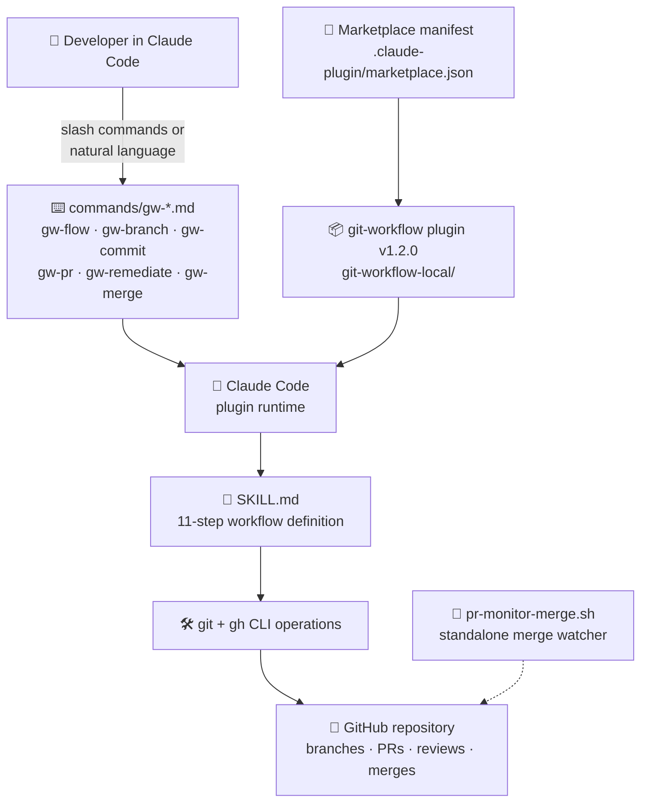

# 🧩 Claude Code Skills

Personal collection of Claude Code skills, plugins, and tools.

**Status:** dormant — last updated April 2026. Currently contains a
single plugin (Git Workflow, below); no further skills are in progress.

## 📑 Table of Contents

- [📑 Contents](#-contents)
- [🏗️ Architecture](#️-architecture)
- [📖 Project wiki (Zread)](#-project-wiki-zread)
- [📄 License](#-license)

## 📑 Contents

### 🔄 Git Workflow Plugin

Complete git workflow automation with emoji-based conventional commits,
PR creation, review remediation, and merge monitoring.

**Install from GitHub (recommended):**

```bash
# Add this repo as a marketplace source
claude plugin marketplace add tupacalypse187/tupacalypse187-claude-skills

# Install the plugin
claude plugin install git-workflow@git-workflow-local
```

**Or from within a Claude Code session:**

```
/plugin marketplace add tupacalypse187/tupacalypse187-claude-skills
/plugin install git-workflow@git-workflow-local
```

**Install from local clone:**

```bash
claude plugin marketplace add /path/to/this-repo
claude plugin install git-workflow@git-workflow-local
```

**Update after changes:**

```bash
claude plugin update git-workflow@git-workflow-local
```

**Usage:**

- Natural language: "Complete git workflow for adding dark mode"
- Slash commands: `/gw-flow`, `/gw-branch`, `/gw-commit`, `/gw-pr`, `/gw-remediate`, `/gw-merge`

Full documentation:

- [git-workflow-local/README.md](git-workflow-local/README.md) — plugin overview and setup
- [git-workflow-local/skills/git-workflow/SKILL.md](git-workflow-local/skills/git-workflow/SKILL.md) — the skill definition itself

### 🔀 pr-monitor-merge.sh

Standalone bash script for monitoring and merging a PR once all checks
pass.

```bash
chmod +x pr-monitor-merge.sh
./pr-monitor-merge.sh <pr-number> [commit-message]
```


## 🏗️ Architecture

This repo is a Claude Code plugin marketplace containing one plugin. The marketplace manifest registers the `git-workflow` plugin; when installed, Claude Code's plugin runtime loads its slash commands and skill definition, and the model executes the workflow by driving the local `git` and `gh` CLIs against the target GitHub repository.



**Components**

- **Marketplace manifest** (`.claude-plugin/marketplace.json`) — registers this repo as a plugin source under the name `git-workflow-local`, pointing at the plugin in `./git-workflow-local`.
- **Plugin manifest** (`git-workflow-local/.claude-plugin/plugin.json`) — the `git-workflow` plugin (v1.2.0) metadata Claude Code uses at install time.
- **Slash commands** (`git-workflow-local/commands/gw-*.md`) — six entry points (`gw-flow`, `gw-branch`, `gw-commit`, `gw-pr`, `gw-remediate`, `gw-merge`); each is a prompt template with frontmatter describing its arguments.
- **Skill definition** (`git-workflow-local/skills/git-workflow/SKILL.md`) — the full workflow the runtime follows: branch → emoji conventional commit → push → structured PR → poll reviews → remediate → reply → monitor until CLEAN → squash merge → branch cleanup.
- **Execution layer** — the workflow runs entirely through the local `git` and `gh` CLIs, so it uses the developer's existing GitHub authentication and git config.
- **Standalone script** (`pr-monitor-merge.sh`) — a bash alternative that watches a single PR and merges it once all checks pass, without the plugin.

**Main flow:** install the plugin from the marketplace → invoke `/gw-flow` (or describe the change in natural language) → Claude Code follows `SKILL.md` step by step, issuing `git`/`gh` commands → the PR is created, reviewed, remediated, monitored, and merged with branches cleaned up.

## 📖 Project wiki (Zread)

This repo includes a generated wiki from the
[Zread CLI](https://zread.ai/cli) in `.zread/` — structured, browsable
documentation of the project. To regenerate after changes:

```bash
zread generate
zread browse   # open in browser
```

See [CLAUDE.md](CLAUDE.md) for version management conventions.

## 📄 License

MIT
